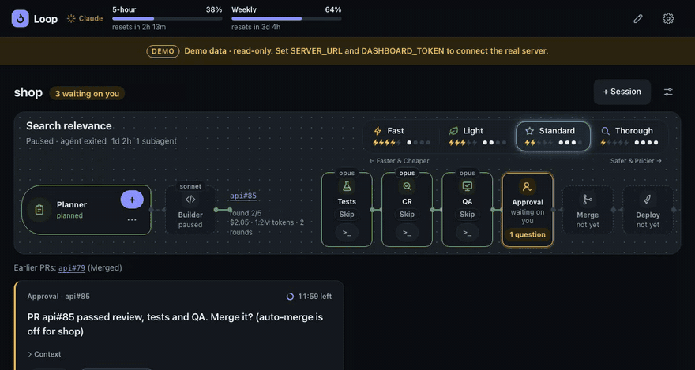
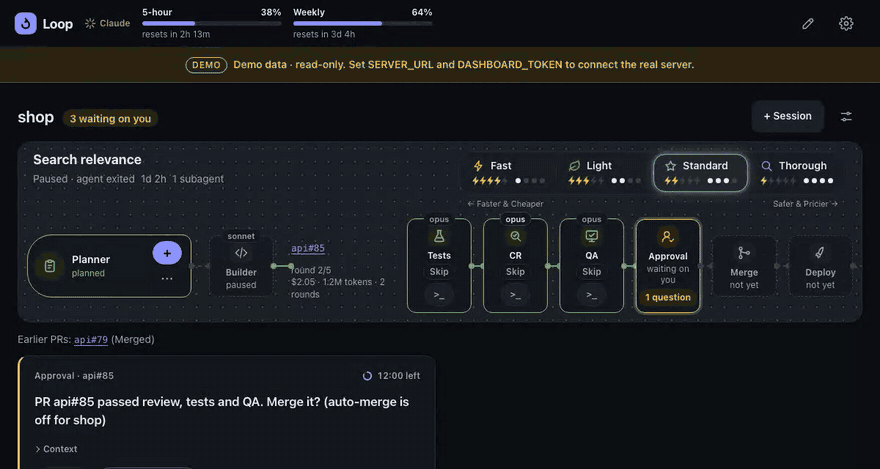
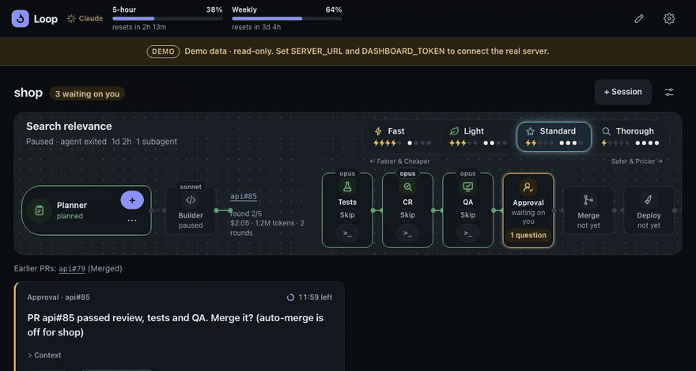

<div align="center">

# Loop Engineering

**Give it a task. It runs Claude Code on your repo in the background, asks you when it's stuck, and takes every pull request through tests, review, QA, merge and deploy.**

[](https://github.com/lanyado/loop-engineering/actions/workflows/ci.yml)
[](LICENSE)
[](package.json)
[](tsconfig.base.json)
[](SECURITY.md)

[Quick start](#quick-start) · [Features](#features) · [Settings](#settings) · [Reference](docs/reference.md) · [Security](SECURITY.md)

<br />



<sub>The dashboard, shown with its built-in demo data.</sub>

</div>

<br />

## Features

- **Background sessions.** Each task runs the Claude Code CLI in tmux, in its own git worktree. When Claude hits its usage limit, the session can move to a free OpenCode model.
- **Questions, not interruptions.** The agent asks through the dashboard as one-tap options with a default answer. If you don't reply in time, the default wins.
- **A PR loop that closes the job.** Optional. Tests, code review by a separate agent, QA, merge and deploy for every PR a session opens. Failures go back to the agent, and a failed deploy is reverted (repos with a Vercel project set).
- **A pipeline you can see.** Every project is a live pipeline, with your Claude 5-hour and weekly limits beside it.
- **Rigor dial.** One control from **Fast** to **Thorough** trades safety against time and money.
- **Yours to edit.** Reorder, remove or add stages and rewrite their prompts, all from the dashboard.

### Answer from the dashboard



### Shape the pipeline



> [!WARNING]
> Everything runs on your machine, reachable only from it, and it starts agents with write access to your repos. It is a personal project, built mostly by the agents it runs, and developed on macOS. Read [SECURITY.md](SECURITY.md) first.

## Requirements

- macOS (Linux is untested), Node 20.19+, git and tmux
- [Claude Code](https://docs.claude.com/en/docs/claude-code), installed and logged in (run `claude` once)
- Optional: [`gh`](https://cli.github.com) for the PR loop, [OpenCode](https://opencode.ai) for the free fallback, and `jq` for the usage meters

`npm run setup` checks all of these and tells you what's missing.

## Quick start

```sh
git clone https://github.com/lanyado/loop-engineering.git
cd loop-engineering
npm install
npm run setup   # checks tools, builds, writes .env with fresh tokens
npm start       # server + dashboard
```

Open the dashboard at **http://127.0.0.1:3737** (setup prints the address if you changed the port). In a second terminal, add a project:

```sh
npm run add-project -- ~/code/my-app            # a git repo with a GitHub remote
npm run add-project -- ~/notes --folder         # or any folder, edited in place
```

**Trust each folder once.** Claude asks "Is this a project you created or one you trust?" the first time it runs in a folder, and a background session can't answer that. Run `claude` once in each project folder and once in your `WORKTREES_ROOT` (`~/loop-worktrees` by default), and choose **Yes, I trust this folder**. If you forget, the session asks you on the dashboard, with the command to fix it.

Then press **+ Session** on the project, type what you want done, and watch the pipeline.

## Settings

| What                                                            | Where                                             |
| --------------------------------------------------------------- | ------------------------------------------------- |
| Top bar items, pipeline stages and their prompts, row details   | Dashboard, the pencil in the top bar              |
| Session model, fallback model, Claude Code / OpenCode on or off | Dashboard, the gear in the top bar                |
| Auto-merge, order, hiding (per project)                         | Dashboard, the slider icon on a project           |
| PR loop, ports, worktrees folder, job limits, providers         | `.env` in the repo root, then restart `npm start` |

These are the `.env` values you're most likely to change. Everything else has a sensible default and is documented in [`.env.example`](.env.example).

| Variable                        | What it does                                                                          |
| ------------------------------- | ------------------------------------------------------------------------------------- |
| `LOOP_ENGINE=on`                | Turns on the PR loop. It merges and reverts for real, so turn on auto-merge with care |
| `WORKTREES_ROOT`                | Where session worktrees go (setup sets `~/loop-worktrees`)                            |
| `CLAUDE_LIMIT=opencode`         | At Claude's usage limit, switch to OpenCode instead of waiting                        |
| `SERVER_PORT`, `DASHBOARD_PORT` | Ports, 8787 and 3737 by default (change `SERVER_URL` along with `SERVER_PORT`)        |

`npm run setup` never overwrites a value you've set, so it's safe to run again after an update.

## Optional extras

**The PR loop.** Run `gh auth login`, set `LOOP_ENGINE=on`, and restart. Every PR a session opens then gets tests, a code review by a separate agent (up to 5 rounds), QA when the change needs it, and a merge when auto-merge is on for that project, or your approval when it's off. After the merge, the loop watches the deploy and reverts it if it fails (for repos with a `vercelProject` set; see [the reference](docs/reference.md#the-pr-loop)).

**Your own add-ins.** Extra channels or integrations you keep to yourself go in a `local/` folder in the repo, which git ignores: the server loads it at start ([how](docs/reference.md#local-add-ins)).

**Rigor, per session.** Above each session's pipeline is a dial from **⚡ Fast** to **🛡 Thorough** that trades safety against time and money in one move. Every level runs every stage; the level sets the agents' effort and how strict the checks are. Fast and Light run only the related tests, block only on real bugs, and give the review 1 and 2 rounds; Standard runs the pipeline as it is (the default); Thorough also asks for tests for every change and runs QA on every PR. The Planner picks the level when it plans, with a reason; your own choice on the dial always wins, and a change applies from the next job ([details](docs/reference.md#rigor-per-session)).

**Skip a check for one PR.** Each check on a PR's lane has **Skip**: after you confirm in the pop-up, the loop treats it as passed for that PR (CI still has to pass, and a skipped code review means the merge waits for you). **Run again** undoes it.

**Your own stages.** Each stage is a prompt file. The pencil in the top bar opens an editor on an example project: reorder, remove or add stages right on its pipeline, edit their prompts and when they run, and Save to apply. Or edit the files directly: a `.md` file in `data/stages/` per stage, and the order in `data/stages/pipeline.json` (format in [packages/loop/stages/README.md](packages/loop/stages/README.md)).

**Usage meters.** To show Claude's 5-hour and weekly limits in the dashboard, add this line to your Claude Code status line script:

```sh
printf '%s' "$input" | /path/to/loop-engineering/scripts/capture-claude-usage.sh   # $input: the status line JSON
```

## Commands

| Command                                         | What it does                                                            |
| ----------------------------------------------- | ----------------------------------------------------------------------- |
| `npm run setup`                                 | Check tools, build, create or complete `.env`                           |
| `npm start`                                     | Run the server and the dashboard (Ctrl-C stops both)                    |
| `npm run add-project -- <path>`                 | Register a project (`--name`, `--branch`, `--folder`, `--outside-home`) |
| `npm run build`                                 | Rebuild after pulling changes                                           |
| `npm test`, `npm run typecheck`, `npm run lint` | The checks CI runs                                                      |
| `npm run dev -w @loop-engineering/dashboard`    | Dashboard in development mode (`SERVER_URL=` for demo data)             |

## More

- [docs/reference.md](docs/reference.md): every package, the HTTP API, the PR loop, folder projects, importing past Claude sessions, and the security model in full
- [SPEC.md](SPEC.md) describes what it does, and [PLAN.md](PLAN.md) the build order and open follow-ups
- [CLAUDE.md](CLAUDE.md): rules for agents working on this repo

## License

[MIT](LICENSE)
